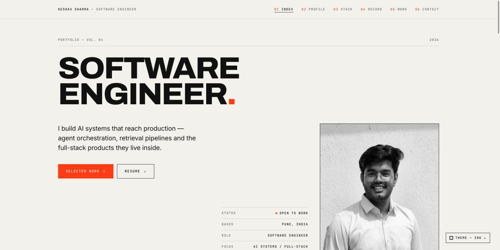
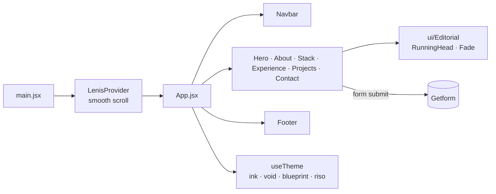

# Keshav Sharma — Portfolio

Personal site for Keshav Sharma, software engineer. It is laid out like an editorial index: a profile, the stack, a work record, and an index of 18 projects you can filter by area.

**Live:** https://keshav-portfolio-kt3b.vercel.app/ · [Resume](https://drive.google.com/file/d/1RH2h5AyXlOd7js6JNPkikzZMWb71f7fu/view?usp=sharing) · [LinkedIn](https://www.linkedin.com/in/keshav-sharma-40284b253/) · [GitHub](https://github.com/keshav1441)



## Sections

| # | Section | Component | What it shows |
|---|---|---|---|
| 01 | Index | `Hero.jsx` | Headline, status panel, resume link |
| 02 | Profile | `About_me.jsx` | Short bio and focus areas |
| 03 | Stack | `Technologies.jsx` | Languages, frontend, backend, data, AI/ML and platform tools |
| 04 | Record | `Experience.jsx` | Roles, each expanding to its bullets and tech |
| 05 | Work | `Project.jsx` | Project index with category filters, links to code and live demos |
| 06 | Contact | `Contact.jsx` | Contact form (Getform) and social links |

## Architecture



It is a static single-page app with no backend. All content, including roles and projects, is plain data at the top of each component, so updating the site means editing one array. Smooth scrolling comes from Lenis, entrance animations from Framer Motion, and `useTheme` switches between four themes (Ink, Void, Blueprint, Riso), defaulting to the OS light or dark preference and remembering the choice in `localStorage`.

```
src/
├── App.jsx, main.jsx, index.css
├── components/        # one file per section, plus Navbar and Footer
│   └── ui/            # shared editorial primitives (RunningHead, Fade)
├── context/           # LenisContext (smooth-scroll provider)
├── hooks/             # useTheme
├── lib/               # scroll helpers
├── styles/            # themes.css
└── assets/            # project images
scripts/optimize-images.mjs   # one-off image compression
```

## Tech stack

| Layer | Technology |
|---|---|
| UI | React 18, Tailwind CSS |
| Motion | Framer Motion, Lenis |
| Build | Vite |
| Forms | Getform |
| Hosting | Vercel |

## Running locally

Requires Node.js 18 or later.

```bash
npm install
npm run dev       # http://localhost:5173
npm run build     # production build into dist/
npm run preview   # serve the production build
npm run lint
```

No environment variables are needed.

## Updating content

- **Roles:** edit `EXPERIENCES` in `src/components/Experience.jsx`.
- **Projects:** edit the project array in `src/components/Project.jsx`. Leave out `demo` when a project has no live deployment.
- **Resume link:** `RESUME_URL` in `src/components/Hero.jsx`.

---

Built by [Keshav Sharma](https://github.com/keshav1441)
